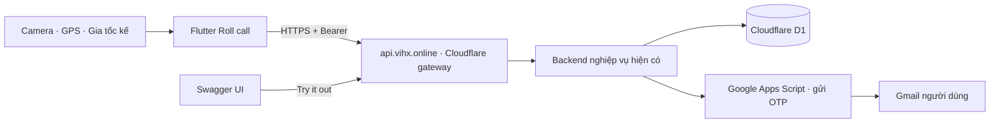
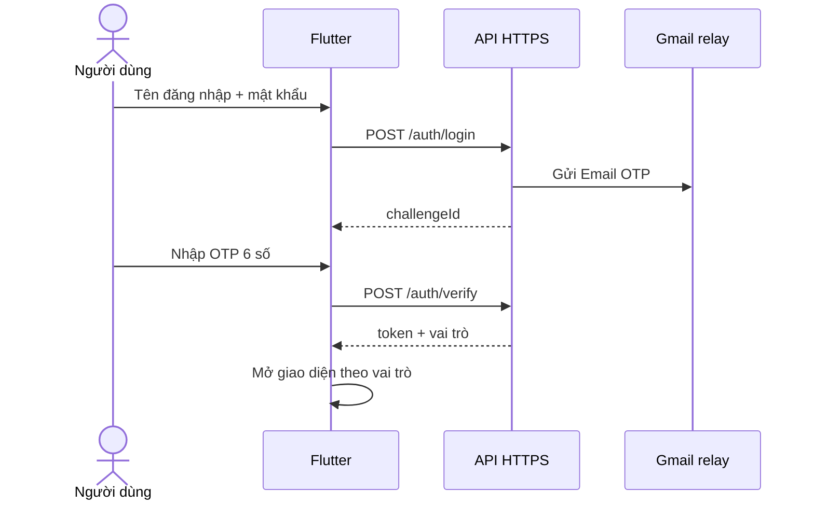
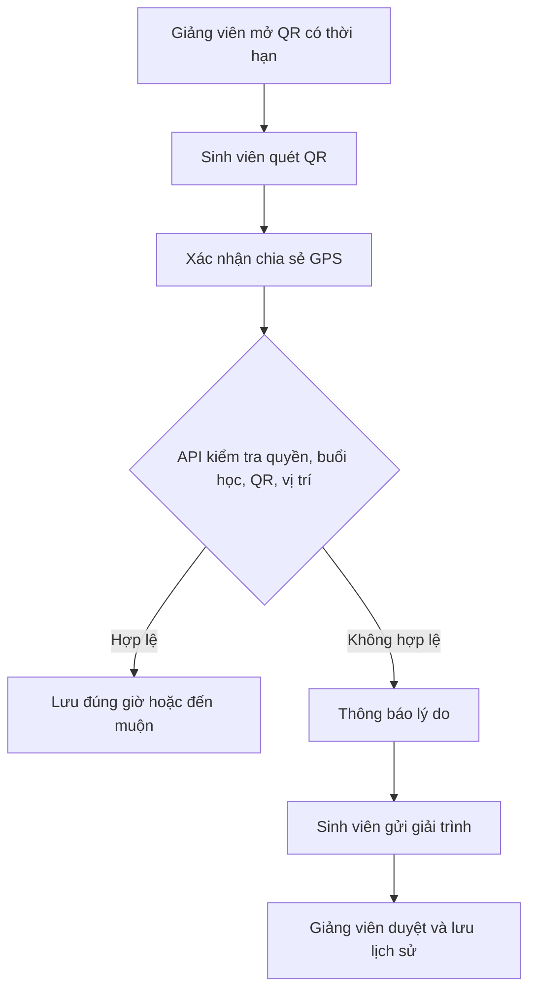

# Roll call — Điểm danh sinh viên


**Trương Tuấn Vĩnh · 2380602577 · Nhóm 4 con mèo**  
Project Flutter: `truong_tuan_vinh_2380602577_diem_danh` · **Phiên bản hiện tại: 1.2.3+6**

Ứng dụng Flutter dành cho Admin, Giảng viên và Sinh viên: xác thực Email OTP, quản lý lớp/buổi học, điểm danh QR kết hợp GPS, cảm biến chuyển động và duyệt giải trình.

## Tải app và truy cập API

| Nội dung | Liên kết |
|---|---|
| APK Android v1.2.3 | [Tải và cài đặt](https://github.com/Vinh-205/Roll-Call/releases/download/v1.2.3/Roll-call-2380602577-v1.2.3.apk) |
| Release, source ZIP và SHA256 | [Bản phát hành v1.2.3](https://github.com/Vinh-205/Roll-Call/releases/tag/v1.2.3) |
| Swagger UI | [api.vihx.online/swagger/](https://api.vihx.online/swagger/) |
| API base URL | `https://api.vihx.online/api` |
| Health check | [GET /api/health](https://api.vihx.online/api/health) |
| Source backend | [backend/](backend/) |
| Source gateway | [cloudflare-gateway/](cloudflare-gateway/) |


App sử dụng HTTPS công khai, không cần chạy backend trên máy tính. Tải APK, cho phép cài từ trình duyệt nếu Android yêu cầu rồi mở Roll call. Thiết bị cần Internet để xác thực và lưu dữ liệu.

## Mới trong v1.2.3

- **Sửa nút bị che:** nội dung có vùng hiển thị riêng phía trên thanh điều hướng; nút **Tạo lớp / Tham gia lớp** không còn nằm dưới thanh này. Kiểm thử cả Admin và Sinh viên ở chiều rộng 360 px, cỡ chữ 130%.
- **Thanh điều hướng kiểu liquid glass:** nền trong mờ, blur, viền sáng, bóng đổ và vùng chọn trượt giữa các mục. Icon Morphicons chuyển hình khi đổi tab. Đây là hiệu ứng kính được dựng bằng Flutter, không phải thành phần Liquid Glass gốc của iOS.
- **Giữ bản sửa QR của v1.2.2:** bộ quét nhận đúng `catcheck:<sessionId>:<token>` từ backend. Đổi tên hiển thị thành Roll call không thay đổi giao thức QR.
- **Giữ các nâng cấp v1.2.x:** sáu ô OTP đều nhau, splash Lottie mới, palette Cosmic/Candy Blue, nút đăng xuất đỏ bầm, ảnh đại diện, cài đặt giao diện và mở khóa sinh trắc học.


Ảnh trên được chụp từ bản v1.2.3 đang chạy trên máy ảo Android.

## Chức năng chính

| Nhóm | Chức năng |
|---|---|
| Đăng ký / đăng nhập | Đăng ký email; xác minh OTP qua Gmail; đăng nhập tên đăng nhập + mật khẩu + Email OTP; đăng xuất |
| Phân quyền | Admin quản trị tài khoản; Giảng viên quản lý lớp phụ trách; Sinh viên truy cập lớp và lịch sử của mình; backend kiểm tra quyền |
| CRUD | Lớp học, buổi học, quản lý thành viên; tạo/sửa/xóa giải trình chờ duyệt; quản trị tài khoản và vai trò |
| QR | Quét camera, mã có thời hạn 90 giây, kiểm tra đúng buổi học và chống điểm danh trùng |
| GPS | Xin quyền, lấy vị trí khi xác nhận điểm danh; kiểm tra độ chính xác và bán kính; không theo dõi vị trí nền |
| Chuyển động | Gia tốc kế trực tiếp, đồ thị và đếm đợt chuyển động; phiên tập trung 25 phút và nhắc nghỉ |
| Giải trình | Sinh viên gửi lý do; Giảng viên/Admin duyệt hoặc từ chối, lưu ghi chú và lịch sử xử lý |
| Hồ sơ | Cập nhật thông tin cá nhân, chọn/xóa ảnh đại diện bằng trình chọn ảnh hệ thống |
| Cài đặt | Cỡ chữ 90–130%, màu nền riêng cho sáng/tối; lưu lựa chọn trên thiết bị |
| Sinh trắc học | Mở khóa phiên đã đăng nhập bằng phương thức sinh trắc học hệ điều hành hỗ trợ, sau lần đăng nhập mật khẩu/OTP |

### Giao diện và animation

- Màu thương hiệu **Cosmic `#23212C`** và **Candy Blue `#B2D5E5`**. Nền tối mặc định dịu hơn: `#35313F`, thẻ `#454151`; có thể chọn nền khác trong Cài đặt.
- Chỉ có **một nút sáng/tối** tại **Cá nhân → Giao diện Sáng / Tối**. Lottie Day to Night chạy thuận/ngược; hiệu ứng lan toàn màn hình giữ nguyên trang và dữ liệu đang nhập.
- Splash dùng **Smartphones Applications.json**, kèm tên Roll call. Launcher icon là hình điểm danh do chủ dự án cung cấp.
- Sáu ô Email OTP cùng kích thước, focus rõ; hỗ trợ dán mã, tự điền và chỉ nhận tối đa sáu chữ số. Đã kiểm thử ở chiều rộng 280 px, cỡ chữ 130%.
- Nút đăng xuất phủ **đỏ bầm `#6B3747` toàn ô**, chữ và icon sáng.
- Hiệu ứng theme và chuyển tab tôn trọng tùy chọn giảm chuyển động của thiết bị.

### Ảnh đại diện và sinh trắc học

**Cá nhân → Đổi ảnh đại diện → Chọn từ thư viện** mở trình chọn ảnh hệ thống. Android 13+ sử dụng Photo Picker để cấp quyền cho ảnh được chọn; máy ảo cần có ảnh trong Pictures/DCIM. Ảnh được sao chép vào bộ nhớ riêng của app, tách theo ID tài khoản và giữ sau khi mở lại. **Ảnh đại diện chưa đồng bộ backend.**

Sau khi đăng nhập mật khẩu + OTP, vào **Cá nhân → Cài đặt ứng dụng → Khuôn mặt / Vân tay**. App chỉ bật tính năng sau khi xác thực sinh trắc học thành công. Lần mở sau, app kiểm tra phiên với API rồi yêu cầu mở khóa; sau hơn một phút ở nền sẽ khóa lại nếu đã bật. Phiên hết hạn hoặc đăng xuất vẫn cần mật khẩu + OTP.

Thiết bị phải hỗ trợ và đã đăng ký sinh trắc học trong Android/iOS Settings. Hệ điều hành quyết định phương thức khả dụng; không phải mọi Android đều cho ứng dụng dùng khuôn mặt. App dùng `local_auth`, không lưu ảnh khuôn mặt hay mẫu vân tay. **Chưa xác nhận mở khóa sinh trắc học thành công trên thiết bị thật đã đăng ký.**

## Cài và chạy source

Yêu cầu Flutter có **Dart >= 3.13.3**, Android SDK và JDK tương thích Android Gradle Plugin. Chạy `flutter doctor` để kiểm tra môi trường.

```bash
git clone https://github.com/Vinh-205/Roll-Call.git
cd Roll-Call
flutter pub get
flutter devices
flutter run -d <device-id>
```

Mở **thư mục gốc có `pubspec.yaml`** trong Android Studio hoặc VS Code. Nên đặt source ở đường dẫn không dấu, ví dụ `D:\AndroidStudioProjects\Roll-Call`.

```bash
flutter build apk --release
```

APK được tạo tại `build/app/outputs/flutter-apk/app-release.apk`. API mặc định đã là `https://api.vihx.online/api`. Muốn dùng môi trường riêng:

```bash
flutter run --dart-define=API_BASE_URL=https://YOUR-API-DOMAIN/api
```

Không cần đưa `.env`, mật khẩu hoặc khóa gửi email vào Flutter để dùng API hiện tại.

### Chạy máy thật và chiếu lên desktop

1. Kết nối USB, bật Gỡ lỗi USB, mở khóa điện thoại và chấp nhận quyền kết nối máy tính.
2. Dùng `flutter devices`, rồi `flutter run -d <device-id>`; hoặc cài APK từ Release.
3. Cài [scrcpy từ nguồn chính thức](https://github.com/Genymobile/scrcpy), chạy:

```bash
scrcpy -d --no-audio
```

`-d` chọn thiết bị USB khi đang mở cả máy ảo. Giữ cáp kết nối trong lúc trình chiếu. Để demo QR, dùng máy ảo đăng nhập Admin/Giảng viên và điện thoại đăng nhập Sinh viên.

## Luồng sử dụng

1. Đăng ký bằng email nhận thư được, nhập OTP từ Gmail. Tài khoản mới là Sinh viên; Admin cấp vai trò Giảng viên khi cần.
2. Giảng viên tạo lớp và buổi học, thiết lập thời gian/vị trí/bán kính điểm danh.
3. Sinh viên tham gia lớp bằng mã lớp.
4. Khi buổi học diễn ra, Giảng viên mở QR; Sinh viên cấp quyền camera, quét mã và xác nhận chia sẻ vị trí. Thiết bị phải trong bán kính, GPS đủ chính xác.
5. Xem kết quả và lịch sử; gửi giải trình khi gặp sự cố để Giảng viên/Admin xử lý.
6. Trong Nhịp học, bật chuyển động trực tiếp và di chuyển nhẹ thiết bị. Cảm biến/timer được dừng theo vòng đời màn hình.
7. Trong Cá nhân, đổi ảnh, chỉnh hồ sơ, cỡ chữ, màu nền, giao diện hoặc thiết lập sinh trắc học.

**Nếu quét QR lỗi:** cập nhật APK từ v1.2.2 trở lên và mở QR mới ở máy Giảng viên. Mã hết hạn sau 90 giây; sai lớp, ngoài thời gian hoặc ngoài bán kính vẫn bị API từ chối.

**Nếu không kết nối được máy chủ sau khi mới đổi domain:** kiểm tra Internet và thử mở health check trên cùng thiết bị. DNS của nhà mạng có thể còn lưu kết quả cũ; có thể chọn DNS riêng tư `one.one.one.one` trong Android Settings nếu mạng hỗ trợ. Không tắt kiểm tra chứng chỉ HTTPS.

## Swagger và kiến trúc API

Mở [Swagger](https://api.vihx.online/swagger/), gọi `POST /auth/login` bằng tài khoản của mình, lấy `challengeId`, rồi gọi `POST /auth/verify` bằng OTP nhận qua Gmail. Sao chép `token`, bấm **Authorize** và dán token nguyên bản, không thêm chữ `Bearer`. Thử `GET /auth/me` hoặc `GET /courses`.

Swagger có logo và favicon Swagger UI; OpenAPI trỏ cùng domain tới `https://api.vihx.online/api`. Các endpoint ghi/xóa tác động dữ liệu thật, nên dùng lớp thử. Không chia sẻ mật khẩu, OTP hoặc token. Xem thêm [link API và endpoint](docs/LINK_API.txt).



`api.vihx.online` là gateway trong tài khoản Cloudflare cá nhân, chuyển tiếp tới backend hiện có để giữ nguyên dữ liệu và phiên đăng nhập. **Chưa di chuyển D1 sang tài khoản cá nhân.** Google Apps Script chỉ hỗ trợ gửi email OTP, không phải API CRUD. Bản sửa QR và giao diện không thay đổi nghiệp vụ backend.





## Kiểm thử và phạm vi xác nhận

| Kiểm tra | Kết quả gần nhất |
|---|---|
| `flutter analyze` | Không có lỗi/cảnh báo |
| `flutter test` | **20 kiểm thử đạt** ở v1.2.3 |
| `node --test cloudflare-gateway/test.mjs` | **4 kiểm thử gateway đạt** |
| Android native QR decoder trên máy ảo | **1 kiểm thử tích hợp đạt**: giải mã ảnh QR bằng bộ quét Android, nhận đúng payload backend, từ chối QR không liên quan |
| APK Android v1.2.3 | Build release và cài trên máy ảo thành công |
| API domain riêng | HTTPS hợp lệ; Swagger/health trả 200; API bảo vệ trả 401 khi thiếu token |

```bash
flutter analyze
flutter test
node --test cloudflare-gateway/test.mjs
flutter test integration_test/qr_protocol_test.dart -d <android-device-id>
```

Kiểm thử QR tích hợp tạo ảnh thử trên thiết bị, không gửi điểm danh hay sửa dữ liệu thật. Khi chạy bài này, Flutter cài app kiểm thử; sau đó chạy lại `lib/main.dart` hoặc cài APK Release để trở về app thường.

OTP thật, camera QR, GPS và chuyển động từng được thử trên Redmi ở bản nền trước các cập nhật giao diện. Bài QR trên máy ảo **không thay thế** việc quét camera và điểm danh GPS đầy đủ trên điện thoại thật. Chưa xác nhận tất cả thành viên chạy bản mới nhất. Source iOS có khai báo quyền nhưng chưa build/kiểm thử trên thiết bị Apple.

## Cấu trúc source và triển khai

| Thư mục | Nội dung |
|---|---|
| `lib/` | Flutter UI, API client, QR parser, theme, avatar và sinh trắc học |
| `assets/` | Branding và Lottie đóng gói trong app |
| `backend/` | Backend nghiệp vụ, D1 schema/migrations và mail relay |
| `cloudflare-gateway/` | Gateway, Swagger UI và cấu hình custom domain |
| `test/`, `integration_test/` | Kiểm thử Flutter và Android |
| `tools/morphicons/` | Công cụ sinh dữ liệu icon từ Morphicons |

App hiện dùng API công khai, không cần triển khai lại backend để chạy. Muốn triển khai môi trường riêng: cấu hình D1, schema/migrations, bí mật runtime theo [EMAIL_OTP.md](docs/EMAIL_OTP.md), rồi deploy bằng tài khoản của mình. Không bật `LOCAL_TEST_MODE` trên production.

Cấu hình gateway `wrangler.jsonc` là địa chỉ workers.dev; `wrangler.custom-domain.jsonc` gắn `api.vihx.online`. Người triển khai riêng phải thay tài khoản/domain bằng thông tin của mình. Hạn mức Cloudflare và dịch vụ gửi mail có thể ảnh hưởng khi vượt quota.

Repository/source ZIP chỉ chứa source và tài liệu kỹ thuật liên quan. Không đưa `.env`, `.private.env`, `.email-setup.json`, `.dev.vars`, token, mật khẩu, thư mục build, báo cáo điểm hoặc lời lồng tiếng lên GitHub.

## Tài nguyên và giấy phép

- **Morphicons 2.0.2:** công cụ sinh dữ liệu gọi `iconToCubics`, `resampleIcon`, `buildPlan`, `interpPolar` từ thư viện chính thức; adapter Flutter vẽ đường cong bằng Canvas và nội suy theo mã MIT. Đây là adapter của dự án, không phải SDK Flutter chính thức của Morphicons. Kiểm thử đối chiếu tọa độ với thư viện JavaScript.
- Dữ liệu icon đã được commit; chạy Flutter không cần Node.js. Muốn tạo lại: `cd tools/morphicons`, `npm ci`, `npm run generate`.
- Icon đầu vào Lucide (ISC), Morphicons (MIT): [giấy phép](docs/licenses/).
- Logo/favicons Swagger từ Swagger UI: [Apache 2.0](cloudflare-gateway/Swagger-UI-LICENSE).
- Icon điểm danh, `Day to Night.json` và `Smartphones Applications.json` do chủ dự án cung cấp; các asset được đóng gói trong app. Nút theme dùng Lottie, icon chức năng dùng Morphicons.
- Tham khảo bố cục từ [Lucian UX/UI patterns](https://lucianlabs.dev/uxui-prompt/).
