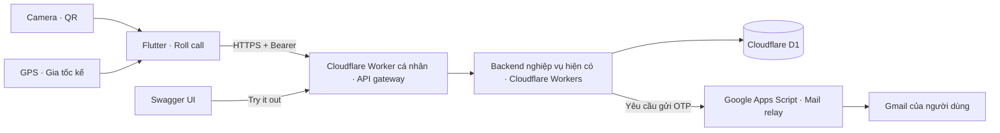
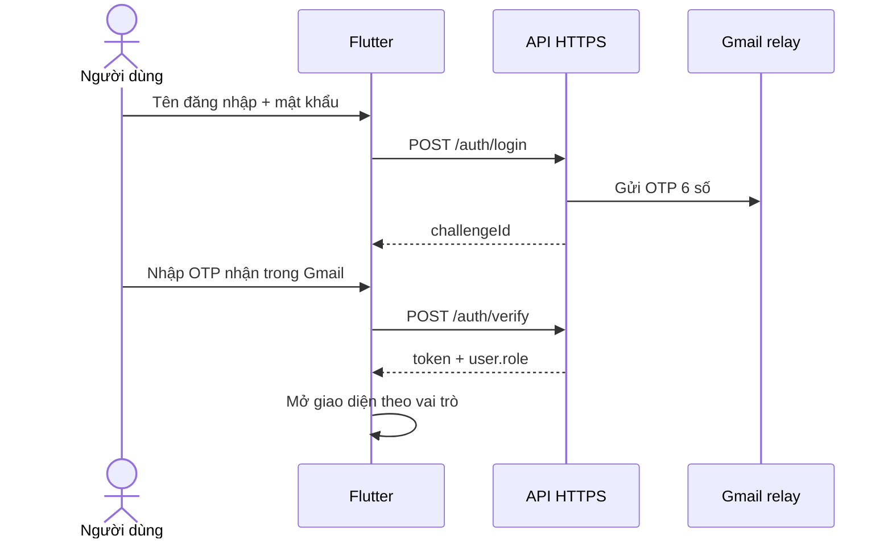
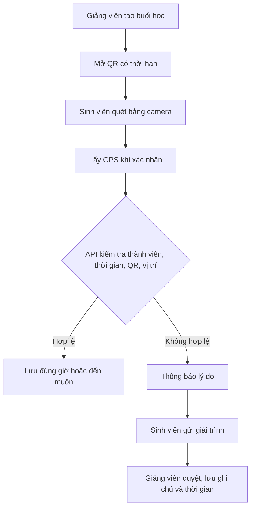

# Roll call — Điểm danh sinh viên


**Trương Tuấn Vĩnh · 2380602577 · Nhóm 4 con mèo**  
Project Flutter: `truong_tuan_vinh_2380602577_diem_danh`. Tên hiển thị: **Roll call**.

Ứng dụng điểm danh bằng QR có thời hạn và GPS, phân quyền Admin / Giảng viên / Sinh viên, nhận OTP thật qua Gmail và xử lý giải trình có lịch sử.

## Tải APK và dùng thử

- [Tải APK Android v1.1.0](https://github.com/Vinh-205/Roll-Call/releases/download/v1.1.0/Roll-call-2380602577-v1.1.0.apk)
- [Các bản phát hành và source ZIP](https://github.com/Vinh-205/Roll-Call/releases)
- [Swagger — xem và thử API](https://truong-tuan-vinh-2380602577-roll-call.truong-tuan-vinh-2577.workers.dev/swagger/)
- [Kiểm tra API](https://truong-tuan-vinh-2380602577-roll-call.truong-tuan-vinh-2577.workers.dev/api/health)


Android: tải APK, cho phép cài đặt từ trình duyệt nếu Android yêu cầu, mở Roll call. Internet là bắt buộc để xác thực và lưu dữ liệu. Không cần chạy máy tính hoặc localhost. Tài khoản mới có vai trò Sinh viên; Admin cấp quyền Giảng viên. Không công khai mật khẩu tài khoản quản trị.

## Chức năng

| Nhóm | Chức năng |
|---|---|
| Tài khoản | Đăng ký email, mật khẩu + Email OTP, đăng xuất, sửa hồ sơ |
| Phân quyền | Admin quản trị tài khoản; giảng viên quản lý lớp phụ trách; sinh viên xem lớp và lịch sử riêng |
| CRUD | Lớp học, buổi học, thành viên lớp; tạo/sửa/xóa giải trình chờ duyệt; quản trị vai trò/tài khoản |
| QR | Giảng viên mở mã có hạn 90 giây; sinh viên quét bằng camera; không điểm danh trùng |
| Vị trí | Lấy GPS khi xác nhận; kiểm tra độ chính xác và bán kính buổi học; không theo dõi nền |
| Chuyển động | Gia tốc kế trực tiếp, đồ thị, đếm đợt chuyển động; phiên tập trung 25 phút và nhắc nghỉ |
| Giải trình | Sinh viên gửi lý do; giảng viên/Admin chấp nhận hoặc từ chối, ghi chú và thời gian xử lý |
| Giao diện | Sáng/tối được lưu, thanh điều hướng nổi, chuyển trang trượt, icon SVG đồng bộ, splash Lottie thích nghi |

Điểm danh kết hợp mã QR có thời hạn và vị trí; màn hình Nhịp học sử dụng cảm biến chuyển động của thiết bị.

## Giao diện

 

## Cài source Flutter

Yêu cầu Flutter có Dart phù hợp `pubspec.yaml` (source hiện dùng Dart >= 3.13.3), Android SDK, JDK tương thích Android Gradle Plugin. Chạy `flutter doctor` trước.

```bash
git clone https://github.com/Vinh-205/Roll-Call.git
cd Roll-Call
flutter pub get
flutter devices
flutter run -d <device-id>
```

Mở **thư mục gốc có `pubspec.yaml`** trong Android Studio hoặc VS Code. Không mở riêng `android/` để chạy Flutter. Nên đặt source ở đường dẫn không dấu như `D:\AndroidStudioProjects\Roll-Call`.

```bash
flutter analyze
flutter test
flutter build apk --release
```

APK tạo tại `build/app/outputs/flutter-apk/app-release.apk`. API mặc định là HTTPS công khai. Có thể đổi môi trường bằng:

```bash
flutter run --dart-define=API_BASE_URL=https://YOUR-API-DOMAIN/api
```

Tên package Flutter giữ nhận diện tác giả. iOS có source nhưng chưa build/kiểm thử trên thiết bị Apple.

## Sử dụng

1. Đăng ký bằng email nhận thư được; nhập OTP 6 số trong Gmail. Đăng nhập cũng yêu cầu mật khẩu và OTP. Kiểm tra Spam nếu chưa thấy thư; chờ 60 giây giữa các lần gửi.
2. Admin mở Cá nhân → Quản trị tài khoản, cấp vai trò Giảng viên cho thành viên phù hợp.
3. Giảng viên tạo lớp và buổi học, lấy GPS thật nếu dùng vùng điểm danh, mở QR khi buổi học đang diễn ra.
4. Sinh viên tham gia bằng mã lớp, bấm Quét QR điểm danh, cho phép camera/vị trí và quét QR trên màn hình giảng viên. Điện thoại phải ở trong bán kính và GPS đủ chính xác.
5. Xem lịch sử. Nếu không điểm danh được, gửi giải trình từ buổi học; giảng viên duyệt và ghi chú.
6. Mở Nhịp học, bật Chuyển động trực tiếp rồi nghiêng điện thoại nhẹ. Khi rời trang, cảm biến/timer được hủy theo vòng đời màn hình.
7. Nút mặt trăng/mặt trời ở Trang chủ, đăng nhập hoặc Cá nhân chuyển giao diện sáng/tối.

- [Link API và endpoint](docs/LINK_API.txt)

## Thử Swagger

Mở `POST /auth/login`, tự nhập tài khoản/mật khẩu. Sao chép `challengeId`; gọi `POST /auth/verify` cùng OTP trong email. Sao chép trường `token`, bấm **Authorize**, dán token nguyên bản, không thêm chữ `Bearer`. Thử `GET /auth/me`, `GET /courses`. Các thao tác ghi/xóa tác động dữ liệu thật; dùng lớp demo để trình diễn. Không quay mật khẩu, OTP, token hoặc tọa độ cá nhân.

## Kiến trúc



Tên miền mới là gateway trong tài khoản Cloudflare cá nhân, chuyển tiếp đến backend hiện có để giữ nguyên dữ liệu và phiên đăng nhập. **Chưa di chuyển D1 sang tài khoản cá nhân**. Google Apps Script chỉ gửi email, không phải API CRUD. Source nghiệp vụ nằm ở `backend/lib/api.ts`; source gateway ở `cloudflare-gateway/`.





## Triển khai backend / OTP

Backend đang hoạt động công khai; để chạy app không cần triển khai lại. Khi tự triển khai một môi trường riêng, tạo D1 và áp dụng schema/migrations trong `backend`, cấu hình bí mật runtime theo [EMAIL_OTP.md](docs/EMAIL_OTP.md), rồi triển khai Worker với Wrangler hoặc luồng hosting tương ứng. Không đưa `.email-setup.json`, `.private.env`, `.dev.vars`, token Cloudflare hay mật khẩu vào Git. Không bật `LOCAL_TEST_MODE` trên production.

`cloudflare-gateway/wrangler.jsonc` trỏ đến tài khoản sở hữu hiện tại; người triển khai riêng phải dùng tài khoản của mình. Worker gateway không chứa secret. Hạn mức Cloudflare/Gmail có thể ảnh hưởng khi vượt quota.

## Nguồn giao diện và giấy phép

[Lucian UX/UI patterns](https://lucianlabs.dev/uxui-prompt/): tham khảo floating dock, form focus, startup transition và bố cục thẻ. [Morphicons](https://www.morphicons.com/) là thư viện chuyển đổi icon cho JavaScript, không có SDK Flutter chính thức; app dùng các đường SVG **Lucide** theo định dạng/nguồn icon được Morphicons hỗ trợ, hiển thị và animate bằng Flutter, không nhúng React/WebView. [Lucide](https://lucide.dev/) theo ISC; ghi nhận tại `docs/licenses`. Logo Roll call được vẽ riêng. Animation được thích nghi từ `Smart TB.json` người dùng cung cấp: giữ các lớp chuyển động, bỏ logo precomposition cũ, đổi màu/nhịp và ghép logo Roll call.

## Kiểm tra source

```bash
flutter analyze
flutter test
node --test cloudflare-gateway/test.mjs
```

Bản 1.1.0 đã build APK release và kiểm tra trên máy ảo. Camera, GPS và cảm biến cần thiết bị Android có phần cứng tương ứng để kiểm thử đầy đủ.
