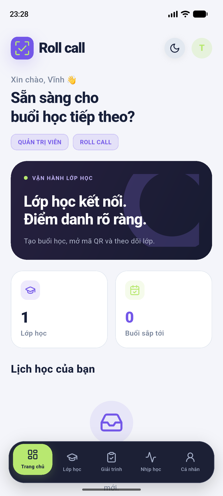
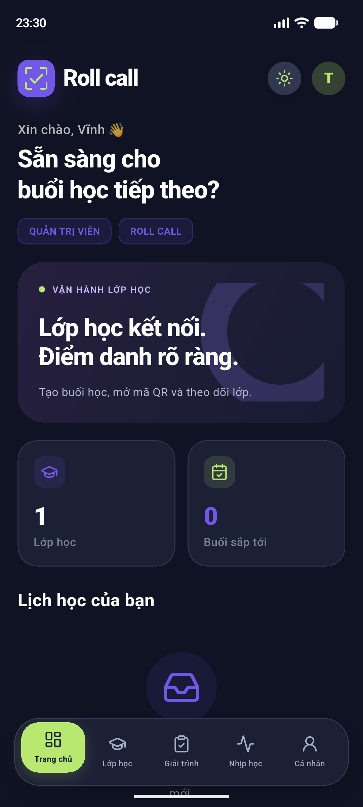
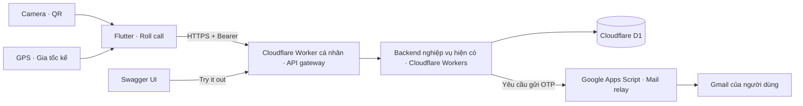
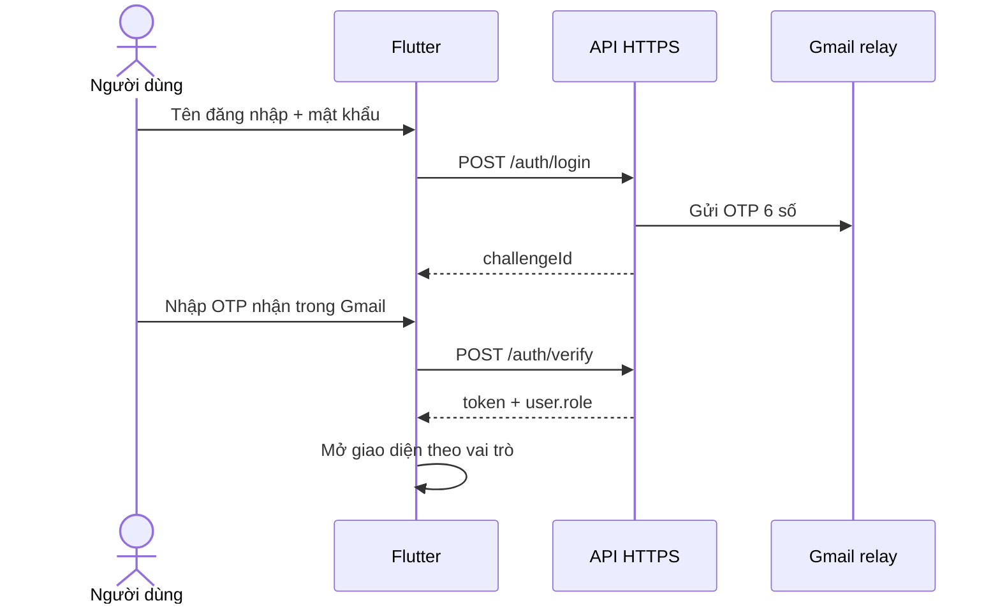
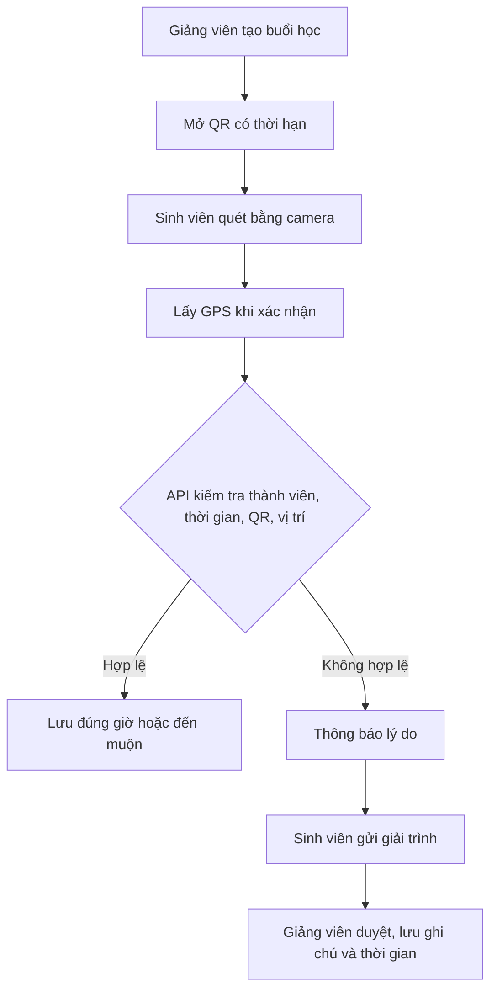

# Roll call — Điểm danh sinh viên


**Trương Tuấn Vĩnh · 2380602577 · Nhóm 4 con mèo**  
Project Flutter: `truong_tuan_vinh_2380602577_diem_danh`. Tên hiển thị: **Roll call**.

Ứng dụng điểm danh bằng QR có thời hạn và GPS, phân quyền Admin / Giảng viên / Sinh viên, nhận OTP thật qua Gmail và xử lý giải trình có lịch sử.

## Tải APK và dùng thử

- [Tải APK Android v1.2.3](https://github.com/Vinh-205/Roll-Call/releases/download/v1.2.3/Roll-call-2380602577-v1.2.3.apk)
- [Các bản phát hành và source ZIP](https://github.com/Vinh-205/Roll-Call/releases)
- [Swagger — xem và thử API](https://api.vihx.online/swagger/)
- [Kiểm tra API](https://api.vihx.online/api/health)


Android: tải APK, cho phép cài đặt từ trình duyệt nếu Android yêu cầu, mở Roll call. Internet là bắt buộc để xác thực và lưu dữ liệu. Không cần chạy máy tính hoặc localhost. Tài khoản mới có vai trò Sinh viên; Admin cấp quyền Giảng viên. Không công khai mật khẩu tài khoản quản trị.

## Chức năng

| Nhóm | Chức năng |
|---|---|
| Tài khoản | Đăng ký email, mật khẩu + Email OTP, đăng xuất, sửa hồ sơ |
| Phân quyền | Admin quản trị tài khoản; giảng viên quản lý lớp phụ trách; sinh viên xem lớp và lịch sử riêng |
| CRUD | Lớp học, buổi học, thành viên lớp; tạo/sửa/xóa giải trình chờ duyệt; quản trị vai trò/tài khoản |
| QR | Giảng viên mở mã có hạn 90 giây; sinh viên quét bằng camera; không điểm danh trùng |
| Vị trí | Lấy GPS khi xác nhận; kiểm tra độ chính xác và bán kính buổi học; không theo dõi nền |
| Chuyển động | Gia tốc kế trực tiếp, đồ thị, đếm đợt chuyển động; phiên tập trung 25 phút và nhắc nghỉ |
| Giải trình | Sinh viên gửi lý do; giảng viên/Admin chấp nhận hoặc từ chối, ghi chú và thời gian xử lý |
| Giao diện | Cosmic `#23212C` / Candy Blue `#B2D5E5`; nút Lottie ngày/đêm; chuyển theme lan tròn toàn màn hình; splash điện thoại kèm tên Roll call |

Điểm danh kết hợp mã QR có thời hạn và vị trí; màn hình Nhịp học sử dụng cảm biến chuyển động của thiết bị.

## Giao diện

Màu chủ đạo: **Cosmic `#23212C`** và **Candy Blue `#B2D5E5`**. Chế độ tối mặc định dùng biến thể Cosmic dịu `#35313F` và thẻ `#454151` để giảm cảm giác quá tối; trong Cài đặt có thể chọn Cosmic gốc hoặc nền sáng hơn. Nút Day to Night chạy thuận/ngược theo chế độ; thay đổi theme lan từ nút bấm ra toàn màn hình và giữ nguyên trang/nội dung đang nhập. Khi thiết bị bật giảm chuyển động, hiệu ứng lan được bỏ qua.

 

## Cài source Flutter

Yêu cầu Flutter có Dart phù hợp `pubspec.yaml` (source hiện dùng Dart >= 3.13.3), Android SDK, JDK tương thích Android Gradle Plugin. Chạy `flutter doctor` trước.

```bash
git clone https://github.com/Vinh-205/Roll-Call.git
cd Roll-Call
flutter pub get
flutter devices
flutter run -d <device-id>
```

Mở **thư mục gốc có `pubspec.yaml`** trong Android Studio hoặc VS Code. Không mở riêng `android/` để chạy Flutter. Nên đặt source ở đường dẫn không dấu như `D:\AndroidStudioProjects\Roll-Call`.

```bash
flutter analyze
flutter test
flutter build apk --release
```

APK tạo tại `build/app/outputs/flutter-apk/app-release.apk`. API mặc định là HTTPS công khai. Có thể đổi môi trường bằng:

```bash
flutter run --dart-define=API_BASE_URL=https://YOUR-API-DOMAIN/api
```

Tên package Flutter giữ nhận diện tác giả. iOS có source nhưng chưa build/kiểm thử trên thiết bị Apple.

## Sử dụng

1. Đăng ký bằng email nhận thư được; nhập OTP 6 số trong Gmail. Đăng nhập cũng yêu cầu mật khẩu và OTP. Kiểm tra Spam nếu chưa thấy thư; chờ 60 giây giữa các lần gửi.
2. Admin mở Cá nhân → Quản trị tài khoản, cấp vai trò Giảng viên cho thành viên phù hợp.
3. Giảng viên tạo lớp và buổi học, lấy GPS thật nếu dùng vùng điểm danh, mở QR khi buổi học đang diễn ra.
4. Sinh viên tham gia bằng mã lớp, bấm Quét QR điểm danh, cho phép camera/vị trí và quét QR trên màn hình giảng viên. Điện thoại phải ở trong bán kính và GPS đủ chính xác.
5. Xem lịch sử. Nếu không điểm danh được, gửi giải trình từ buổi học; giảng viên duyệt và ghi chú.
6. Mở Nhịp học, bật Chuyển động trực tiếp rồi nghiêng điện thoại nhẹ. Khi rời trang, cảm biến/timer được hủy theo vòng đời màn hình.
7. Chỉ có một nút Day to Night nhỏ tại Cá nhân → Giao diện Sáng / Tối. Bấm để đổi theme với hiệu ứng lan tròn.

- [Link API và endpoint](docs/LINK_API.txt)

## Ảnh đại diện và thư viện ảnh

Trong **Cá nhân**, chạm ảnh đại diện hoặc **Đổi ảnh đại diện → Chọn từ thư viện**. Trình chọn ảnh hệ thống cấp quyền cho ảnh được chọn; Android 13+ dùng Photo Picker, Android cũ dùng trình chọn tệp/ảnh. Máy ảo cần có ảnh trong Pictures/DCIM để chọn. Ảnh được sao chép vào bộ nhớ riêng của ứng dụng, tách theo ID tài khoản, giữ sau khi khởi động lại và có thể xóa. Ảnh đại diện hiện chỉ lưu trên thiết bị, chưa đồng bộ backend. iOS đã khai báo mô tả quyền thư viện ảnh; chưa kiểm thử trên thiết bị Apple.

## Cài đặt và sinh trắc học

**Cá nhân → Cài đặt ứng dụng** cho phép đổi cỡ chữ 90–130%, chọn màu nền riêng cho sáng/tối, cập nhật hồ sơ và ảnh đại diện. Các lựa chọn được lưu trên thiết bị. Nút Day to Night chỉ có một vị trí trong Cá nhân.

Sau lần đăng nhập mật khẩu + Email OTP, có thể bật **Khuôn mặt / Vân tay**. Ứng dụng yêu cầu xác thực sinh trắc học thành công trước khi lưu lựa chọn. Lần mở app sau dùng phiên đã được lưu bảo mật, kiểm tra token với API rồi yêu cầu sinh trắc học trước khi hiển thị các trang đã đăng nhập. Khi phiên hết hạn hoặc sau khi đăng xuất, vẫn cần mật khẩu + OTP. Sau hơn một phút ở nền, ứng dụng yêu cầu mở khóa lại nếu đã bật tính năng.

Dùng `local_auth` của Flutter, `FlutterFragmentActivity` và Android `USE_BIOMETRIC`; iOS có `NSFaceIDUsageDescription`. Thiết bị/hệ điều hành quyết định phương thức khả dụng; không đảm bảo mọi điện thoại Android đều cho ứng dụng dùng nhận diện khuôn mặt. Không lưu ảnh khuôn mặt, mẫu vân tay hoặc mật khẩu. Nếu chưa đăng ký sinh trắc học trên thiết bị, màn hình hướng dẫn thiết lập hoặc tiếp tục dùng OTP. Máy ảo cần tự đăng ký vân tay ảo trong Android Settings để thử giao diện xác thực thật. Các kiểm thử tự động sử dụng authenticator giả lập, chưa thay thế kiểm thử phần cứng trên điện thoại thật.

## Thử Swagger

Mở `POST /auth/login`, tự nhập tài khoản/mật khẩu. Sao chép `challengeId`; gọi `POST /auth/verify` cùng OTP trong email. Sao chép trường `token`, bấm **Authorize**, dán token nguyên bản, không thêm chữ `Bearer`. Thử `GET /auth/me`, `GET /courses`. Các thao tác ghi/xóa tác động dữ liệu thật; dùng lớp demo để trình diễn. Không quay mật khẩu, OTP, token hoặc tọa độ cá nhân.

## Kiến trúc



Tên miền mới là gateway trong tài khoản Cloudflare cá nhân, chuyển tiếp đến backend hiện có để giữ nguyên dữ liệu và phiên đăng nhập. **Chưa di chuyển D1 sang tài khoản cá nhân**. Google Apps Script chỉ gửi email, không phải API CRUD. Source nghiệp vụ nằm ở `backend/lib/api.ts`; source gateway ở `cloudflare-gateway/`.





## Triển khai backend / OTP

Backend đang hoạt động công khai; để chạy app không cần triển khai lại. Khi tự triển khai một môi trường riêng, tạo D1 và áp dụng schema/migrations trong `backend`, cấu hình bí mật runtime theo [EMAIL_OTP.md](docs/EMAIL_OTP.md), rồi triển khai Worker với Wrangler hoặc luồng hosting tương ứng. Không đưa `.email-setup.json`, `.private.env`, `.dev.vars`, token Cloudflare hay mật khẩu vào Git. Không bật `LOCAL_TEST_MODE` trên production.

`cloudflare-gateway/wrangler.jsonc` trỏ đến tài khoản sở hữu hiện tại; người triển khai riêng phải dùng tài khoản của mình. Worker gateway không chứa secret. Hạn mức Cloudflare/Gmail có thể ảnh hưởng khi vượt quota.

## Nguồn giao diện và giấy phép

[Lucian UX/UI patterns](https://lucianlabs.dev/uxui-prompt/) được tham khảo cho bố cục. **Morphicons 2.0.2 được sử dụng thực sự ở bước tạo dữ liệu icon**: script `tools/morphicons/generate.mjs` gọi các hàm chính thức `iconToCubics`, `resampleIcon`, `buildPlan`, `interpPolar`. Flutter vẽ các đường cong/kế hoạch đó trực tiếp bằng Canvas, với nội suy polar và spring chuyển từ mã nguồn MIT. Không nhúng WebView; đây là adapter Flutter của dự án, không phải SDK Flutter chính thức của Morphicons. Các nút điều hướng, play/pause, hiện/ẩn mật khẩu dùng kế hoạch chuyển hình; tất cả icon dùng đường cong đã chuẩn hóa qua Morphicons. Test đối chiếu tọa độ Flutter với kết quả thư viện JavaScript chính thức.

Để tạo lại dữ liệu: `cd tools/morphicons`, `npm ci`, `npm run generate`. Dữ liệu sinh ra đã được commit nên chạy Flutter không cần Node.js. Nguồn icon đầu vào Lucide (ISC), Morphicons (MIT), giấy phép ở `docs/licenses`.

Icon điểm danh và hai animation `Day to Night.json`, `Smartphones Applications.json` do chủ dự án cung cấp. Nút Day to Night dùng Lottie theo yêu cầu riêng; icon các chức năng dùng Morphicons. Các asset đóng gói trong app, không cần tải animation qua mạng.

## Kiểm tra source

```bash
flutter analyze
flutter test
node --test cloudflare-gateway/test.mjs
```

Bản 1.2.0 đã build APK release và kiểm tra trên máy ảo. Camera, GPS và cảm biến cần thiết bị Android có phần cứng tương ứng để kiểm thử đầy đủ.

### Nhập Email OTP

Sáu ô mã xác thực có chiều rộng bằng nhau, cùng đường cơ sở và trạng thái focus rõ ràng. Một trình nhập hệ thống hỗ trợ dán mã, tự điền OTP và chỉ nhận tối đa sáu chữ số. Đã kiểm thử bố cục rộng 280 px với cỡ chữ 130%.

### Sửa tương thích QR (1.2.2)

Ứng dụng nhận đúng định dạng `catcheck:<sessionId>:<token>` do backend hiện tại cấp. Tên hiển thị Roll call không thay đổi giao thức QR; kiểm tra thời hạn, quyền, GPS và trùng điểm danh vẫn thực hiện ở API.

### Thanh điều hướng kính (1.2.3)

Thanh điều hướng nổi dùng nền trong mờ, blur, viền phản sáng và vùng chọn trượt. Nội dung có vùng hiển thị riêng, giữ nút Tạo lớp/Tham gia lớp phía trên thanh điều hướng. Kiểm thử bố cục ở màn hình rộng 360 px, cỡ chữ 130% cho cả Admin và Sinh viên.
